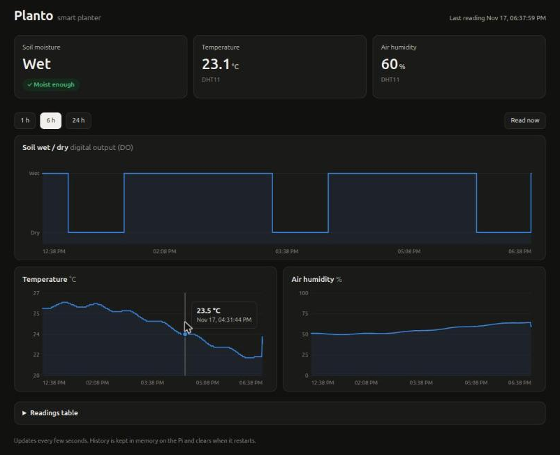
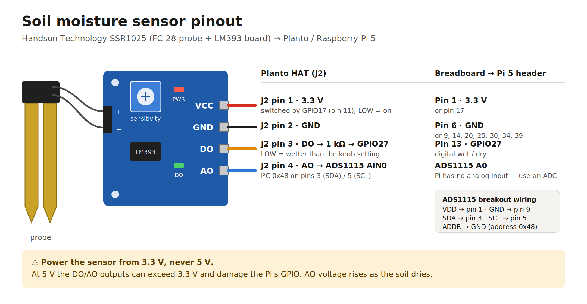

# Planto

Smart planting system built on a **Raspberry Pi 5** running **[Nerves](https://nerves-project.org/)** (Elixir).
It monitors soil moisture and air temperature/humidity (DHT11), waters the plant with a small pump, and streams/snaps images from a Pi camera.



*Live dashboard served by the Pi at http://planto.local (shown here with simulated readings).*

## Hardware

KiCad 9 project: [`planto/plant/`](planto/plant/) — a Pi 5 HAT that sits on the 40-pin header.

| Block | Parts | Pi 5 pin |
|---|---|---|
| Moisture ADC | ADS1115 (U1), I²C addr `0x48`, AIN0 = sensor AO | GPIO2 SDA (pin 3), GPIO3 SCL (pin 5) |
| Air temp / humidity | DHT11 on J4 (`1 VCC  2 DATA  3 GND`), 10k pull-up R7, 100 nF C4 | GPIO4 (pin 7) |
| Sensor power switch | AO3401A P-FET (Q1), 100k pull-up keeps it off at boot | GPIO17 (pin 11) — **LOW = sensor on** |
| Sensor digital out | LM393 DO via 1k | GPIO27 (pin 13) |
| Pump driver | AO3400A N-FET (Q2), SS14 flyback, 47 µF, screw terminal J3 | GPIO22 (pin 15) — HIGH = pump on |
| Status LED | Green LED + 330 Ω | GPIO23 (pin 16) — HIGH = on |
| ADC alert/ready | ADS1115 ALERT/RDY, 10k pull-up | GPIO24 (pin 18) |



- **Soil sensor** (J2, 4-pin 2.54 mm): `1 VCC  2 GND  3 DO  4 AO` — Handson Technology SSR1025 (FC-28 type resistive probe + LM393 board), run at 3.3 V.
  Power it only while reading (GPIO17 low for ~10–50 ms) to slow probe corrosion.
- **Pump**: 5 V from the Pi's 5 V rail (keep it under ~1 A).
- **Camera**: Pi camera on the Pi 5's own CSI/MIPI connector (not on the HAT).

## Firmware (Nerves)

Nerves project in [`firmware/`](firmware/), target `rpi5`.

- Reads the soil sensor and the DHT11 every 30 s. With `soil_analog: false`
  (the default, in `config/config.exs`) only the sensor's DO pin is used and the
  dashboard shows wet/dry; set it to `true` once an ADS1115 is wired to AO to get
  a moisture %.
- Serves a live dashboard at **http://planto.local** (port 80): current values,
  24 h charts for soil moisture, temperature and humidity, and a readings table.
- JSON API: `GET /api/latest`, `GET /api/history?hours=N`, `POST /api/sample`.
- History is kept in memory (24 h) and clears on reboot.
- The DHT11 is decoded from kernel-timestamped GPIO edges (the Nerves Pi 5
  system has no `dht11` kernel driver).

### Build and burn

```sh
cd firmware
export MIX_TARGET=rpi5
mix deps.get
NERVES_WIFI_SSID='your-network' NERVES_WIFI_PSK='your-password' mix firmware
mix burn            # writes the microSD card (asks which drive / for sudo)
# later updates over Wi-Fi, no SD card needed:
mix upload planto.local      # or the Pi's IP address
```

Wi-Fi details are read at build time and are never stored in git.
After boot: open http://planto.local, or `ssh planto.local` for an IEx shell
(`Planto.latest()`, `Planto.read_now()`).

### Run the dashboard on your laptop

```sh
cd firmware && iex -S mix     # simulated sensors, http://localhost:4000
```

### Soil calibration

Edit `soil_calibration` in `firmware/config/config.exs`: `dry_mv` = reading
with the probe in dry soil, `wet_mv` = reading in water (the "Soil sensor
voltage" tile shows the live value).

## Status

- [x] Schematic (ERC clean)
- [ ] PCB layout (65 × 56.5 mm HAT outline)
- [x] Nerves firmware: sensors + web dashboard
- [ ] Pump control and camera snapshots
